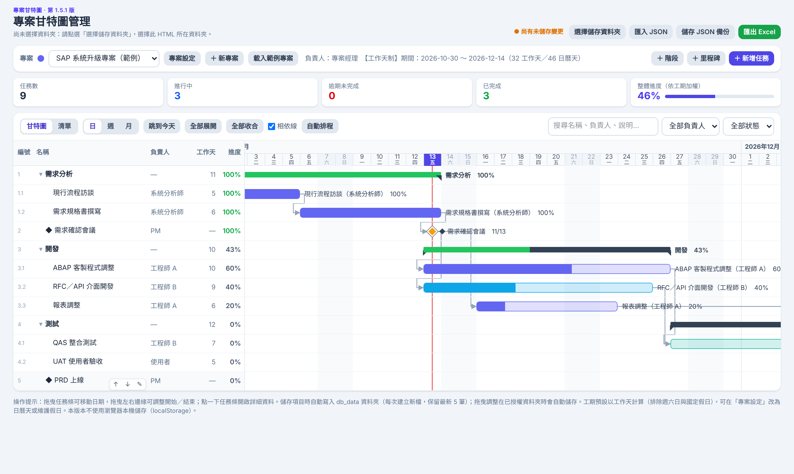

# 專案甘特圖管理

單一 HTML 檔的專案管理工具：甘特圖、階段／里程碑、前置任務、工作天排程、工作處理紀錄，資料以 JSON 存在**自己電腦的資料夾**，不需要伺服器。



## 功能

- **多專案**：專案名稱、負責人、代表色、說明
- **甘特圖**：日／週／月檢視、今天紅線、週末與國定假日底色；拖曳任務條調整日期
- **階段、任務、里程碑**：階段可收合，日期與進度由子任務自動彙總
- **前置任務**：相依連線、衝突紅線、「自動排程」依相依關係順延
- **工作天計算**：排除週六日、國定假日，支援補班日；可改為日曆天
- **建議開始日**：自動接在前一項或前置任務之後
- **工作處理紀錄**：富文字（可貼截圖）、工時統計
- **清單檢視**：搜尋、負責人／狀態／逾期篩選
- **匯出 Excel**：任務清單、甘特圖、處理紀錄、假日設定 4 個工作表
- **JSON 備份**：寫入 `db_data/`，每次存新檔、自動保留最新 5 筆

## 使用方式

1. 用 **Chrome 或 Edge**（電腦版）開啟 `index.html`，或開啟本專案的 GitHub Pages 網址。
2. 點「選擇儲存資料夾」，選一個你要存資料的資料夾（會在裡面建立 `db_data/`）。
3. 點「載入範例專案」試用，或「＋ 新專案」開始建立。

> 也可以用「匯入 JSON」載入 `sample/範例專案.json`。

### 瀏覽器支援

| 瀏覽器 | 支援程度 |
|---|---|
| Chrome／Edge（電腦） | 完整功能 |
| Firefox、Safari、手機、平板 | 可檢視與編輯，但無法寫入資料夾，儲存時改為下載 JSON |

## 資料與隱私

- 所有資料只存在**使用者自己選擇的資料夾**，不會上傳到 GitHub 或任何伺服器。
- `db_data/` 已列在 `.gitignore`，請勿把真實資料提交到儲存庫。
- 頁面會從 CDN 載入 Tailwind CSS、Quill、DOMPurify；匯出 Excel 時載入 ExcelJS，需要網路連線。

## 檔案結構

```
├── index.html          主程式（單一檔案）
├── CHANGELOG.md        修改記錄
├── docs/screenshot.png 截圖
└── sample/範例專案.json 範例資料
```

## 版本

目前版本：**v1.5.1**，詳見 [CHANGELOG.md](CHANGELOG.md)。
